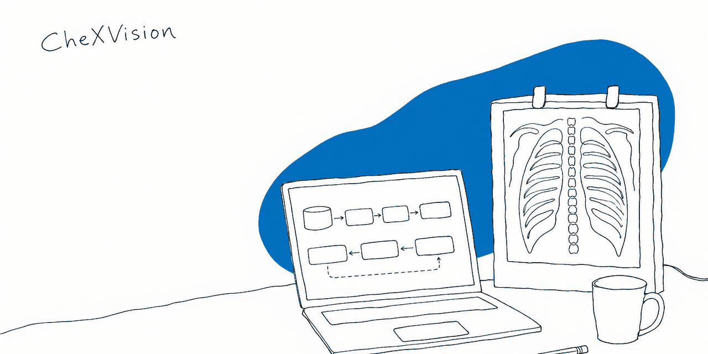
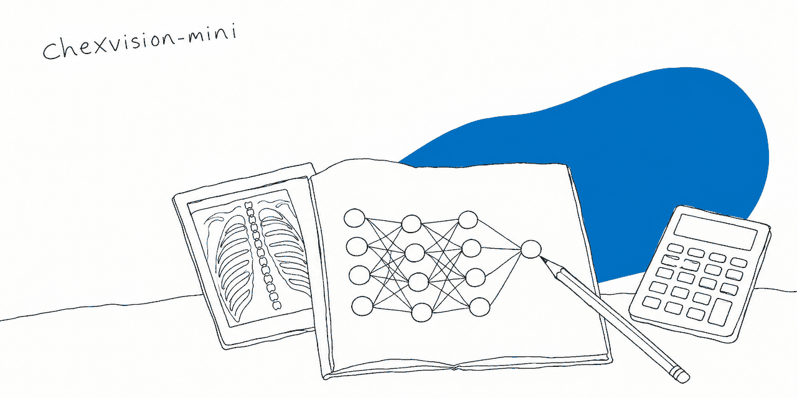
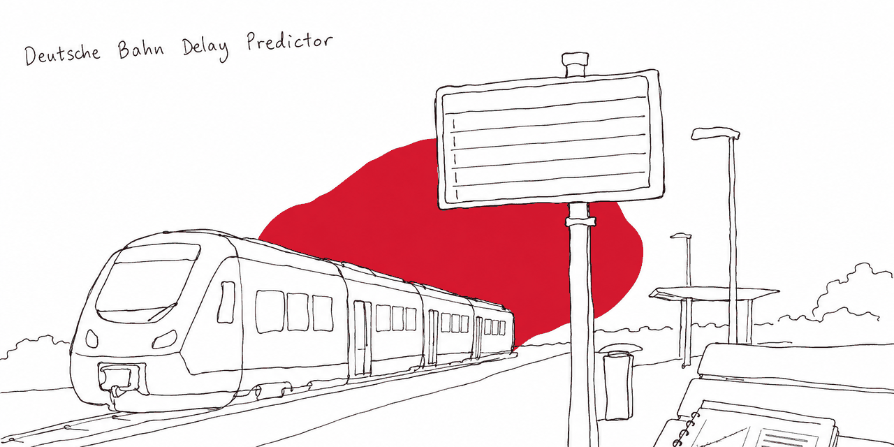
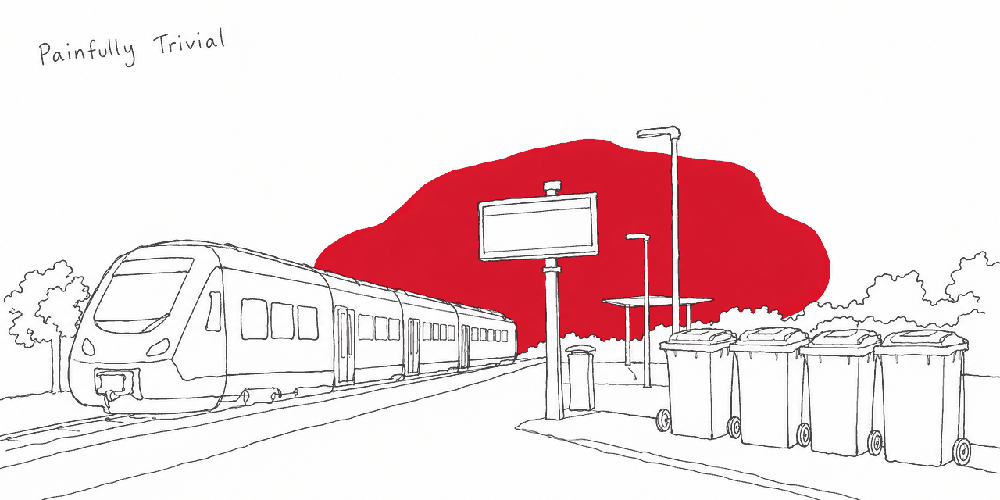
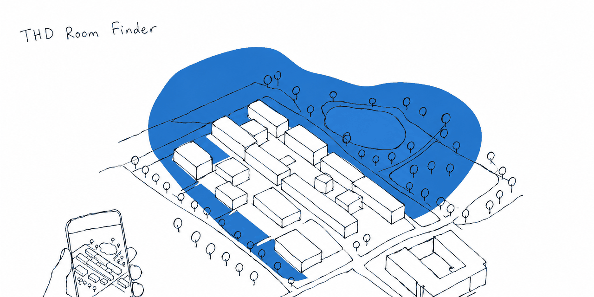
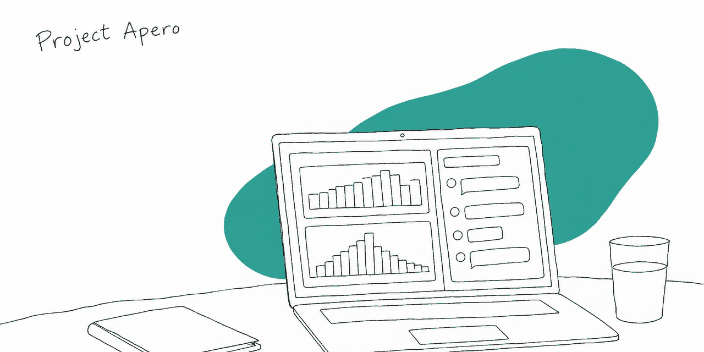
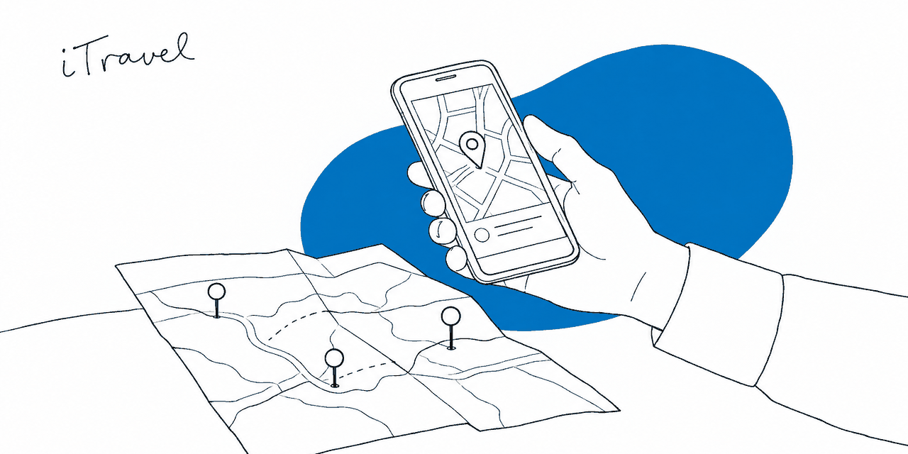
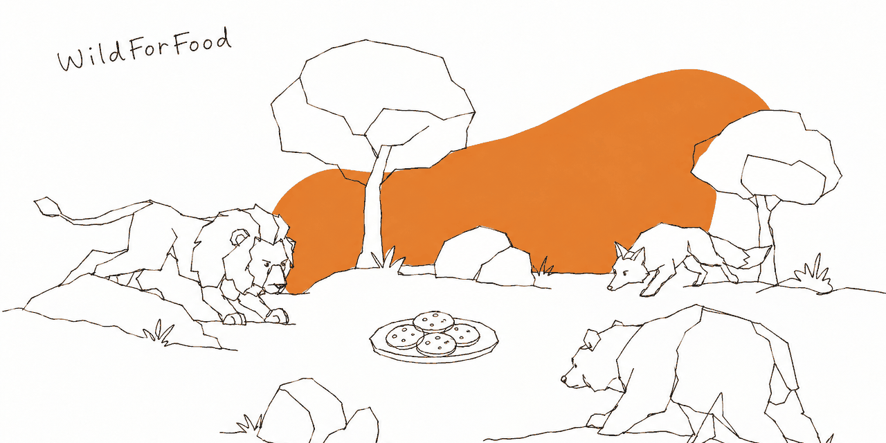
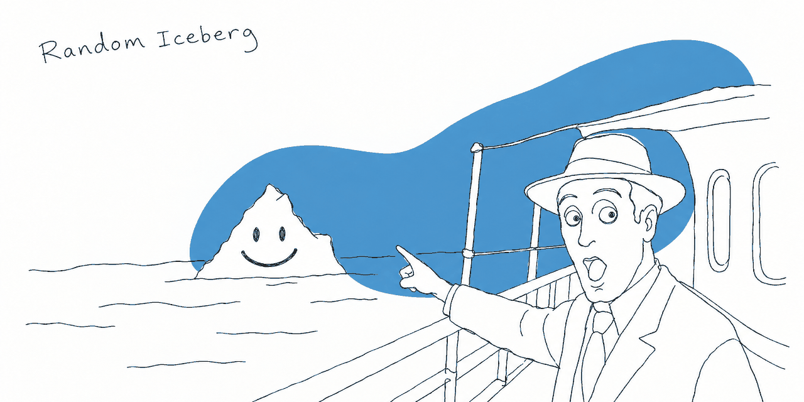
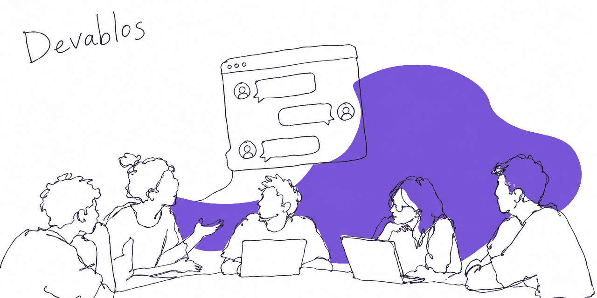

# Banners

Hand-drawn banners for my repositories, kept together in one place. Each one is also at `.github/banner.png` in its own repository, where it heads the README and serves as the social preview.

They were drawn with OpenAI's `gpt-image-2.5-flare` from two kinds of reference: my LinkedIn banner for the hand – a thin, wobbly pen line and one flat colour – and each project's own material for what's in the picture.

| Banner | Repository |
| --- | --- |
|  | [`arudaev/chexvision`](https://github.com/arudaev/chexvision) |
|  | [`arudaev/chexvision-mini`](https://github.com/arudaev/chexvision-mini) |
|  | [`arudaev/ml-db-delay-paper`](https://github.com/arudaev/ml-db-delay-paper) |
|  | [`arudaev/Painfully-Trivial`](https://github.com/arudaev/Painfully-Trivial) |
|  | [`arudaev/THD-Room-Finder`](https://github.com/arudaev/THD-Room-Finder) |
|  | [`arudaev/Document-Conversion-Solutions`](https://github.com/arudaev/Document-Conversion-Solutions) |
|  | [`arudaev/Project-Arepo`](https://github.com/arudaev/Project-Arepo) |
|  | [`arudaev/AI-Conversational-Engine`](https://github.com/arudaev/AI-Conversational-Engine) |
|  | [`arudaev/iTravel`](https://github.com/arudaev/iTravel) |
|  | [`arudaev/WildForFood`](https://github.com/arudaev/WildForFood) |
|  | [`random-iceberg/docker-compose`](https://github.com/random-iceberg/docker-compose) |
|  | [`THD-AI-2023/Devablos-Project-V2`](https://github.com/THD-AI-2023/Devablos-Project-V2) |
